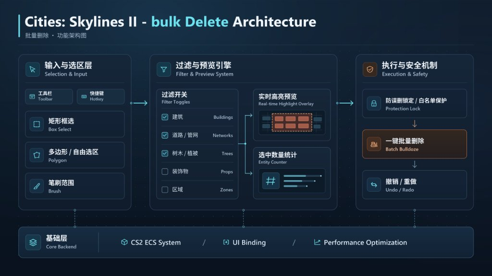

# Bulk Delete · 批量删除（`MarqueeDelete`）


`MarqueeDelete` 是《城市：天际线 II》（Cities: Skylines II）的批量拆除与独立全局撤回模组。  
当前版本为 **v2.7.3**（GitHub Release **1.1**），兼容与符号校验基于游戏 **1.6.4f1**（MVID `46198354D4F94D23BF327E3C085D8B92`）。

---

## ⚠️ 重要声明与风险提示（AI 全程制作）

> **本模组的全部制作过程完全由 DeepSeek、GPT 与 Gemini AI 控制完成。**
>
> 从核心 C# ECS 系统、React/TypeScript UI 界面、自动化测试脚本，到封面图与文档简介，均由上述 AI 模型协作生成并直接主导修改。作者本人**并非程序员、不会编写代码**，仅负责提出需求并在游戏内实测验收。
>
> **使用前请务必了解以下潜在风险：**
> - 可能导致游戏出现**掉帧、卡顿、模拟速度变慢、车辆停滞**等性能问题；
> - 批量操作或撤回后，可能出现**道路/人行道连接异常、建筑无路径、局部地形或分区错乱**；
> - 极端情况下仍存在**游戏卡死、崩溃或损坏当前存档进度**的风险。
>
> **订阅或安装前请先备份重要存档**，强烈建议先在新存档中试用。如果无法接受上述风险，请勿使用。

---

## 一、功能特性

1. **三种选区方式与精细微调**：支持矩形（跟随镜头/锁定正南北）、多边形（最多 64 顶点）与自由笔画选区，实时计算面积、周长与格数；锁定选区后可左键补选、右键剔除。
2. **资产/分区过滤与路口设施独立移除**：支持五大建筑分区与六类静态资产筛选；在地面视图展开 **管网细分 → 路口设施**，可单独移除或批量清理普通路口的红绿灯与过街斑马线。
3. **多重安全防线**：联动原版地下视图；默认开启删除确认，包含市政/独特/重点建筑时弹出名录二次确认；自动保护地图边缘外部连接、行政区与地图边界区块。
4. **独立全局撤回（`Ctrl+Z`）与选择性分步恢复**：
   - 支持撤回上一步的批量删除、新建建造、推土机单删、道路/建筑升级替换、分区涂刷与地形改造；
   - 道路撤回支持血缘对账与原地复原（处理 `Combine` 延长合并、`Replace` 替身替换与 `Split` 中段拆分保留两半段，并对二次接路提供拓扑保护）；
   - 建筑支持与原生 `Prefab` 一致的 `SubNet` 原子重建；
   - 撤回仅恢复几何与基础属性，不还原住户、就业、经济、车辆与市民模拟状态。
5. **高亮配色自定义**：18 项高亮颜色、3 项透明度滑块与 4 套内置预设（含色盲友好模式）。

---

## 二、模块架构



### 1. 兼容层与生命周期
- **`Mod.cs` / `Compatibility.cs`**：模组入口与四组兼容边界检测（`SearchAndPick`、`DeletionSubmit`、`UndoRebuild`、`UIAccess`），在非目标游戏版本下自动进入安全兼容模式。
- **`Settings.cs` / `Localization.cs`**：持久化设置项、全局撤回历史深度与快捷键绑定（`Ctrl+Z`）、中英本地化词条。

### 2. 选区、渲染与拆除管线
- **`MarqueeDeleteToolSystem.cs`**：核心 `ToolSystem`，管理选区输入、微调、确认弹窗、分帧预算拆除与恢复状态。
- **`Selection.cs` / `SelectionLogic.cs`**：矩形/多边形/自由笔画空间拾取、顶点简化与纯逻辑校验。
- **`BuildingOverlay.cs` / `AssetOverlay.cs` / `AssetOverlayLogic.cs`**：建筑分区轮廓与高亮覆盖层渲染（按图元预算动态合批/抽稀）。
- **`Cascade.cs` / `DeletionPolicies.cs` / `RoadFacilities.cs`**：级联依赖闭包计算（`Owner`、`Attached`、`SubNet`、`SubArea` 与边界节点保护）、重点建筑识别及路口设施修改。

### 3. 全局撤回与选择性恢复引擎
- **`GlobalUndo.cs` / `GlobalUndoPolicy.cs`**：
  - `GlobalUndoPreApplySystem` 与 `GlobalUndoPostApplySystem` 在原版工具提交前后捕获网络血缘（`Temp.m_Original`、`TempFlags`）、分区格子与 `64×64` 地形高度图块；
  - 精确区分纯建路连带调整与语义升级（`Build` vs `UpgradeReplace`），通过三次贝塞尔共线判定识别中段拆分链；
  - 按 `DeletingCreated → WaitingPostDelete → RestoringInPlaceNets → RestoringDeleted → RestoringZoneAndTerrain` 分阶段安全回放。
- **`DeletionUndo.cs` / `SelectiveUndoLogic.cs` / `UndoBatchPolicy.cs`**：按帧预算提交静态资产重建请求，支持建筑 `Prefab` 驱动的一次性 `SubNet` 重建、`MarqueeDeleteUndoSystem` 残留载体清理，以及暂停/恢复后的实体身份防错接校验。

### 4. 前端界面（`ui/src/mods/`）
- **`MarqueeDeleteUISystem.cs` / `bindings.ts`**：ECS 状态与 React UI 的实时同步绑定。
- **`bulldoze-marquee-section.tsx` / `marquee-header.tsx` / `marquee-footer.tsx`**：推土机内嵌选区面板、筛选开关与分步撤回控制。
- **`global-undo-hud.tsx`**：独立全局撤回悬浮窗（双子星图标、历史记录列表、类型过滤开关）。
- **`color-palette-modal.tsx` / `important-confirm-modal.tsx`**：配色编辑弹窗与重要建筑二次确认弹窗。

---

## 三、本地构建

在 Windows 上准备游戏本体、Roslyn `csc.exe`、PowerShell 7、Node.js 18+ 与 .NET 8 SDK。先根据本机环境核对 `build.ps1` 中的 `$managed` 与 `$csc` 路径，然后在 `MarqueeDelete/` 目录运行：

```powershell
$env:CSII_USERDATAPATH = Join-Path $PWD.Path 'dist\_ui_stage'
npm --prefix ui ci
npm --prefix ui run build
.\build.ps1
```

关闭游戏后可运行 `.\install.ps1` 安装构建产物。

## 四、测试与验证

```powershell
dotnet restore .\tests\MarqueeDelete.Tests.csproj
dotnet restore .\tests\DeletionRegression.csproj
.\tests\verify_version_sync.ps1
.\tests\verify_cecil.ps1
.\tests\run_tests.ps1
```

当前离线验证基线（v2.7.3）：
- `verify_cecil.ps1`：1,253 个成员引用 / 381 个类型引用 / 0 未解析
- `MarqueeDelete.Tests`：3,292 passed, 0 failed
- `DeletionRegression`：267 passed
- `UndoHarness`：40 scenarios, 334 checks passed

更多使用细节参见 [使用说明](使用说明.md) 与 [版本策略](VERSIONING.md)。
