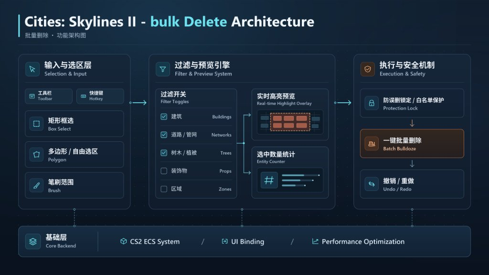
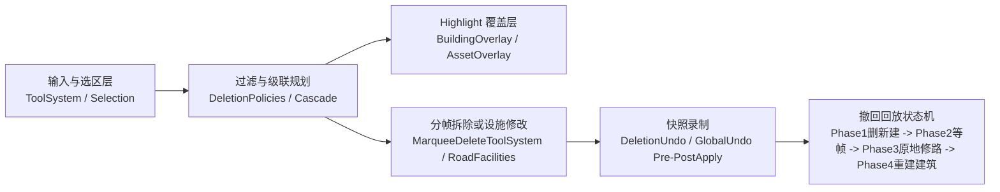

# city2models — Bulk Delete · 批量删除（Cities: Skylines II）


> **当前发布版本**：Mod **v2.7.2**（GitHub Release **1.1**）｜ **目标游戏构建**：Cities: Skylines II `1.6.4f1`（MVID `46198354D4F94D23BF327E3C085D8B92`）

---

## ⚠️ 重要声明与风险提示（AI 全程制作）

> **本模组的全部制作过程完全由 DeepSeek、GPT 与 Gemini AI 控制完成。**
>
> 从核心 C# ECS 系统、React/TypeScript UI 界面、离线测试框架与 Cecil 符号校验，到封面图与文档介绍，均由上述 AI 模型协作生成并直接主导修改。作者本人**并非程序员、不会编写代码**，仅负责提出需求并在游戏内实测验收。
>
> **使用前请务必了解以下潜在风险：**
> - 可能导致游戏出现**掉帧、卡顿、模拟速度变慢、车辆停滞**等性能问题；
> - 批量拆除或撤回后，可能出现**道路/人行道连接异常、建筑无路径、局部地形或分区错乱**；
> - 极端情况下仍存在**游戏卡死、崩溃或损坏当前存档进度**的风险。
>
> **使用或订阅前请先备份重要存档**，强烈建议先在新存档中试用。如果无法接受上述风险，请勿使用。

---

## 一、核心功能一览

1. **三种框选模式与交互微调**
   - **矩形框选**：支持跟随镜头视角旋转或锁定正南北方向，实时显示选区长宽（格数/米数）与面积。
   - **多边形点选**：逐点布点自动连线（最多 64 顶点，可调节），支持点击起点 / `Enter` 闭合、右键 / `Backspace` 回退顶点。
   - **自由笔画**：按住左键绘制任意闭合轮廓，自动简化顶点并在超限时提示。
   - **点选增减**：锁定选区后，左键单击可补选遗漏对象，右键单击可单独剔除误选目标。

2. **精细筛选与安全保护**
   - **建筑分区筛选**：独立开关住宅、商业、工业、办公、公共服务建筑。
   - **资产类型筛选**：独立开关道路管网（支持**管网细分**与**路口设施**：红绿灯 / 过街斑马线独立移除）、树木、摆件、贴花、自定义地表与车辆市民。
   - **地上 / 地下分层**：联动原版地下视图切换，地面拆除与地下隧道/管网互不干扰。
   - **防误删保护**：默认开启删除确认；选区包含市政服务、独特或重点建筑时弹出名录二次确认（支持一键排除重要建筑）；自动保护地图边缘外部连接、行政区与地图边界区块。

3. **独立全局撤回（`Ctrl+Z`）与选择性分步恢复**
   - **全局操作历史栈**：独立捕获并撤回上一步的**批量删除、新建建造、原版推土机单删、道路/建筑升级替换、分区涂刷与地形改造**（可在设置中按类别开关并调节保留步数）。
   - **道路血缘对账与原地撤回**：针对 CS2 建路时对相邻旧路的三种改写路径，尽量原地复原而不先删后建：
     - **端点直连延长合并（`Combine`）**：原地缩短回旧曲线并将远端节点移回原位；若后续又在该节点接出新路，自动跳过缩短保护后建路段。
     - **节点 / 相邻边替换（`Replace`）**：保持替身实体存活并原地还原旧几何与属性，同时重映射相邻边端点。
     - **中段丁字 / 十字拆分（`Split`）**：只删除新建支路，保留原有主路两半段（0 闪烁、路边建筑不断链），并对交叉节点触发 `Updated` 刷新。
   - **建筑原子重建**：与 `Prefab` 同步的一键重建建筑及其 `SubNet`（如公园内部人行道）、`SubObject`、`SubArea` 与升级附件，并自动清理残留 `CourseSplitSystem` 载体。
   - **选择性分步撤回**：支持对批量删除结果按六大类资产（建筑、道路管网、地表、树木、摆件、贴花）自由勾选恢复，按帧预算分批提交并支持随时暂停、继续或停止。
   - *边界说明*：撤回仅恢复几何与基础属性，不还原住户、就业、经济、车辆或市民模拟状态。

4. **高亮视觉自定义**
   - 覆盖 18 项选区与资产高亮颜色及 3 项透明度调节，内置 4 套一键预设（经典、高对比霓虹、色盲友好、柔和半透明）。

---

## 二、系统架构设计



整个模组采用 **“CS2 ECS 后端（C# `.NET 4.7.2`） + Gameface UI 前端（React/TypeScript） + 离线双轨验证（Unit/Regression/Harness/Cecil）”** 的分层架构，全部核心代码位于 `MarqueeDelete/` 目录：

```
MarqueeDelete/
├── Mod.cs                          # 模组入口（v2.7.2），初始化兼容层、设置与本地化
├── Compatibility.cs                # 四组兼容边界校验（SearchAndPick / DeletionSubmit / UndoRebuild / UIAccess）
├── Settings.cs                     # Mod 设置项、快捷键绑定（含全局撤回 Ctrl+Z）与颜色持久化
├── Localization.cs                 # 多语言本地化字典注册
│
├── 【选区、高亮与拆除管线】
├── MarqueeDeleteToolSystem.cs      # 核心 ToolSystem：选区状态机、点选微调、安全拦截与分帧执行调度
├── Selection.cs / SelectionLogic.cs# 矩形/多边形/笔画几何拾取与纯逻辑判定
├── BuildingOverlay.cs              # 建筑分区轮廓高亮渲染
├── AssetOverlay.cs / AssetOverlayLogic.cs # 资产覆盖层合批与图元预算裁剪
├── Cascade.cs                      # 级联依赖闭包规划（Owner/Attached/SubNet/SubArea/Node保护）
├── DeletionPolicies.cs             # 重要建筑识别、外部连接/行政区保护与过滤策略
├── RoadFacilities.cs               # 路口设施（红绿灯/斑马线）独立移除与分批更新
│
├── 【全局撤回与分步恢复引擎】
├── GlobalUndo.cs                   # PreApply/PostApply 事务录制、道路血缘对账、多阶段回放状态机
├── GlobalUndoPolicy.cs             # 操作归类（Build/UpgradeReplace等）、贝塞尔共线拆分判定、拓扑策略
├── DeletionUndo.cs                 # 快照捕获与分步重建（建筑 Prefab SubNet 原子重建、邻居刷新）
├── SelectiveUndoLogic.cs / UndoBatchPolicy.cs # 实体身份匹配、分批帧预算与防篡改校验
│
├── 【UI 前端 (ui/src/mods/)】
├── MarqueeDeleteUISystem.cs        # C# <-> React 双向绑定与事件桥接
├── ColorLibrary.cs                 # 18 项颜色配置与 4 套内置预设
├── bulldoze-marquee-section.tsx    # 主面板、选区模式、筛选与选择性撤回进度控制
├── global-undo-hud.tsx             # 独立全局撤回悬浮 HUD（Gemini 双子星图标、历史栈与范围开关）
├── color-palette-modal.tsx         # 高亮配色编辑弹窗
├── important-confirm-modal.tsx     # 重要/市政建筑二次确认弹窗
│
└── 【测试与校验工具链 (tests/)】
    ├── verify_cecil.ps1            # 基于 Mono.Cecil 的 Game.dll MVID 与全符号解析校验
    ├── MarqueeDelete.Tests.cs      # 纯逻辑单元测试（3,292 项）
    ├── DeletionRegression.cs       # 拆除与过滤回归测试（267 项）
    └── harness/Program.cs          # 模拟 CS2 ECS 环境的 UndoHarness（40 个完整场景 / 334 项断言）
```

### 核心数据流与生命周期



1. **兼容层先行门闩（`Compatibility.cs`）**：启动时校验 `Game.dll` 的 MVID 与四组关键程序边界，若检测到未知游戏版本则自动降级为只读预览或安全兼容模式。
2. **工具态与独立撤回解耦**：
   - 批量拆除与选区微调由 `MarqueeDeleteToolSystem` 驱动，支持分帧提交避免单帧卡顿；
   - 全局撤回（`GlobalUndoPreApplySystem` / `GlobalUndoPostApplySystem`）独立挂载在原版工具应用前后，无需打开批量删除面板即可通过 `Ctrl+Z` 或顶部/HUD 按钮撤回原版建造、推土机、道路升级、分区与地形操作。
3. **全链路离线双轨验证**：所有涉及几何判定、血缘对账、级联拆除与重建的逻辑均可在不启动游戏的情况下通过 `.\tests\verify_cecil.ps1`、`.\tests\run_tests.ps1` 与 `.\tests\verify_version_sync.ps1` 自动验证。

---

## 三、本地构建与验证

在 Windows 上准备 Cities: Skylines II 本体、Roslyn `csc.exe`、PowerShell 7、Node.js 18+ 与 .NET 8 SDK，进入 `MarqueeDelete/` 目录执行：

```powershell
# 1. 构建 UI 前端
$env:CSII_USERDATAPATH = Join-Path $PWD.Path 'dist\_ui_stage'
npm --prefix ui ci
npm --prefix ui run build

# 2. 构建 C# 程序集
.\build.ps1

# 3. 运行全套验证（版本一致性、Cecil 符号校验、单测/回归/ECS 沙盒）
.\tests\verify_version_sync.ps1
.\tests\verify_cecil.ps1
.\tests\run_tests.ps1
```

关闭游戏后可运行 `.\install.ps1` 部署到本地 Mods 目录。详细项目说明与版本策略见 [MarqueeDelete/README.md](MarqueeDelete/README.md) 与 [MarqueeDelete/VERSIONING.md](MarqueeDelete/VERSIONING.md)。
